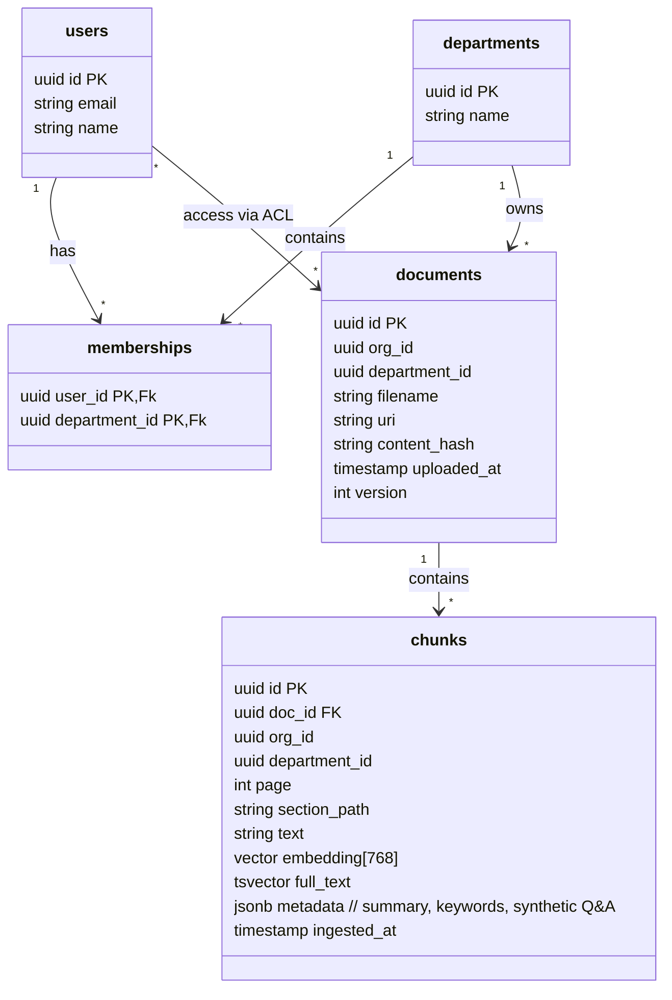

# Departmental Knowledge Assistant – Architecture Blueprint

---

## 1. High‑Level Overview

```mermaid
flowchart LR
    A[Client (Web / Mobile)] --> B[FastAPI Gateway]
    B --> C[Auth Service (JWT)]
    B --> D[Chat Service]
    B --> E[Upload / Ingestion API]
    D --> F[Planner & Tool Orchestrator]
    F --> G[Hybrid Retrieval Engine]
    G --> H[Cross‑Encoder Reranker]
    F --> I[Text‑to‑SQL / Calculator Tools]
    H --> J[LLM Generation]
    J --> K[Faithfulness Validator]
    K --> L[Response (with citations)]
    E --> M[Ingestion Workers (Celery/Arq)]
    M --> N[Parser & Chunker]
    N --> O[Enrichment (summaries, keywords, Q&A)]
    O --> P[PostgreSQL + pgvector]
    P --> Q[Object Store (MinIO/S3) for raw files]
    style A fill:#f9f,stroke:#333,stroke-width:2px
    style B fill:#bbf,stroke:#333,stroke-width:2px
    style C fill:#bbf
    style D fill:#bbf
    style E fill:#bbf
    style F fill:#ddf
    style G fill:#ddf
    style H fill:#ddf
    style I fill:#ddf
    style J fill:#cfc
    style K fill:#cfc
    style L fill:#cfc
    style M fill:#ffd
    style N fill:#ffd
    style O fill:#ffd
    style P fill:#fdd
    style Q fill:#fdd
```

---

## 2. Core Components & Responsibilities

| Component | Primary Role | Key Technologies | Remarks |
|---|---|---|---|
| **FastAPI Gateway** | HTTP entry point, routing, request validation | FastAPI, Pydantic | Thin layer – delegates to services |
| **Auth Service** | Verify JWT, resolve user → department ACLs | PyJWT, PostgreSQL ACL tables | No trust on client‑provided department list |
| **Upload / Ingestion API** | Accept files, trigger async jobs | FastAPI, Celery/Arq, MinIO SDK | Accept PDF/DOCX/MD/Code; compute content‑hash |
| **Parser & Chunker** | Layout‑aware extraction, hierarchical chunking | Docling / Unstructured, custom chunker (256‑512 token) | Store heading hierarchy, page numbers, parent‑child links |
| **Enrichment** | Summaries, keywords, synthetic Q&A | LLM (provider‑agnostic wrapper), LangChain utilities | Cached per‑chunk to avoid recompute |
| **PostgreSQL + pgvector** | Store metadata, vectors, full‑text, ACL fields | pgvector, GIN indexes, JSONB for tags | Single source of truth for search & ACL enforcement |
| **Hybrid Retrieval Engine** | Vector + BM25 fusion (Reciprocal Rank Fusion) | pgvector similarity, `tsvector` full‑text, custom SQL view | Filters `department_id` *inside* the query |
| **Cross‑Encoder Reranker** | Re‑score top‑k candidates | Sentence‑Transformers cross‑encoder, GPU/CPU pool |
| **Planner & Tool Orchestrator** | Single‑step LLM planner → decides which tool(s) to call | OpenAI/Claude/Anthropic wrapper, tool‑calling schema |
| **Text‑to‑SQL / Calculator** | Structured queries on relational tables, arithmetic | SQLAlchemy, DuckDB for in‑memory exec, `math` lib |
| **LLM Generation** | Produce answer, embed citations inline | Provider‑agnostic wrapper, templating system |
| **Faithfulness Validator** | One‑shot LLM judge to verify claim‑citation alignment | Same LLM provider, prompt template |
| **Tracing & Observability** | End‑to‑end latency, cost, metrics | OpenTelemetry exporter → Grafana/Jaeger, Langfuse integration |
| **Eval Harness** | Automated golden‑set runs, red‑team tests | PyTest, custom evaluation scripts, CI pipeline |
| **Cache Layers** | Prompt, query, response caches (Redis) | Redis, TTL policies, cache‑key includes `user_id` + `department_id` |
| **Scheduler** | Daily ingestion cron, on‑demand re‑index | Celery beat / Arq periodic tasks |

---

## 3. Database Schema (Simplified)



*All retrieval queries join `chunks` with `memberships` (or use a `department_id` filter derived from JWT) *inside* the SQL, never post‑filtering.*

---

## 4. Ingestion Pipeline (Daily + On‑Demand)

1. **Upload → Store raw file** in MinIO (`s3://bucket/org/<org_id>/dept/<dept_id>/doc/<doc_id>.<ext>`)
2. **Compute SHA‑256 hash**; upsert `documents` row (skip if unchanged).
3. **Schedule Celery task** `process_document(doc_id)`.
4. **Parser** extracts pages, headings, tables, images.
5. **Chunker** creates hierarchical chunks (max 512 tokens) preserving:
   - `section_path` (e.g., `"Introduction > Goals"`)
   - `page` number
   - parent‑child IDs for context expansion.
6. **Enrichment** (async, idempotent):
   - Generate embedding via provider‑agnostic model.
   - Summarize chunk, extract keywords, synthesize 2‑3 "what‑if" questions.
7. **Upsert chunks** into PostgreSQL with `ON CONFLICT (id) DO UPDATE`.
8. **Clean‑up**: delete chunks whose source file was removed.

All steps are **idempotent**; Celery retries are safe because operations are upserts keyed by `chunk_id` (derived from doc_id + checksum).

---

## 5. Access Control (Zero‑Trust)

- JWT contains `sub` (user_id) and `org_id`. The service queries `memberships` to fetch allowed `department_id`s *per request*.
- Every retrieval SQL includes:
  ```sql
  SELECT ... FROM chunks c
  JOIN memberships m ON m.department_id = c.department_id
  WHERE m.user_id = :user_id
  AND (vector_similarity < :threshold OR ts_rank_cd(...))
  ```
- No client‑side filtering. Even if a prompt tries to inject `department: "Finance"`, the planner cannot override the SQL guard.
- **Test**: property‑based test that for any random user and any random query, the returned `department_id`s ⊆ user's memberships.

---

## 6. Retrieval & Reranking Flow

1. **User query** → optional **query rewrite** (LLM) for clarity.
2. **Hybrid search**:
   - Vector similarity (`pgvector <-> query_embedding`).
   - BM25 (`tsvector @@ plainto_tsquery`).
   - Combine with Reciprocal Rank Fusion (RR=1/(rank+1)).
3. **Top‑k (≈30) → Cross‑Encoder** re‑score, keep top‑5‑8.
4. **Pass chunks to planner** for possible tool calls (e.g., structured DB query).
5. **Generation** uses a *system prompt* that forces citation format:
   ```
   [Source: {doc_id}, page {page}, chunk {chunk_id}]
   ```
6. **Validator** runs a second LLM pass:
   - Checks each claim vs cited chunks.
   - If fails → request *more* context (next 5 chunks) once; else return `not found`.

---

## 7. Planner & Tool‑Calling (Single‑Loop)

- **Prompt**: "You are a departmental knowledge assistant… You may call tools: `search`, `sql_query`, `calc`. Use at most 3 tool calls and then produce the answer."
- **Tool Set**:
  - `search(query, top_k)` → hybrid retrieval (reuse step 2).
  - `sql_query(sql)` → execute read‑only SQL on **department‑specific tables** (e.g., HR metrics).
  - `calc(expression)` → safe arithmetic.
- **Loop limit**: max 5 iterations; after that abort with “unable to answer”.

---

## 8. Generation & Validation Details

- **Prompt Template** includes placeholders:
  - `{retrieved_chunks}` – each chunk numbered and formatted.
  - `{question}` – original user query.
- **Citation format** enforced by a regular‑expression check before returning.
- **Validator Prompt**:
  ```
  Verify that every factual statement in the assistant's answer is directly supported by at least one cited chunk. List any unsupported statements.
  ```
- **Retry policy**: one extra retrieval round (increase `top_k` to 15) if validator reports missing evidence.

---

## 9. Evaluation, Red‑Team & Monitoring

| Aspect | Metric / Tool |
|---|---|
| Retrieval | recall@k, MRR, nDCG (evaluate against golden chunk IDs) |
| Answer faithfulness | Langfuse/Llama‑judge score, human spot‑check |
| Latency | 95‑pctile response time (OpenTelemetry) |
| Cost | LLM token count per query (tracked in Langfuse) |
| ACL leaks | Automated property‑based tests, CI job that attempts cross‑dept queries |
| Prompt injection | Test suite feeding malicious system prompts inside documents |
| Cache hit rate | Redis stats |

CI pipeline runs the golden dataset **per department** on each PR; failures block merges.

---

## 10. Operational Concerns

- **Caching**: 
  - *Prompt cache* – store LLM‑generated rewrite per query hash.
  - *Query cache* – store hybrid search results for identical embeddings (TTL 5 min).
  - *Response cache* – for frequent FAQ‑type questions (TTL 1 hour).
- **Retry & Fallback**:
  - Celery retries with exponential back‑off for ingestion failures.
  - Retrieval fallback to pure BM25 if vector index is unavailable.
- **Observability**:
  - OpenTelemetry spans for each pipeline stage.
  - Grafana dashboards for latency heatmaps, error rates, cache hit ratios.
- **Security**:
  - MinIO bucket policies scoped to `org_id/department_id`.
  - Rate‑limit per user token (e.g., 30 queries/min).

---

## 11. Suggested Improvements / Trade‑offs

| Area | Option | Pros | Cons |
|---|---|---|---|
| **Chunk Size** | 256‑512 tokens (current) vs 128 tokens | Smaller chunks improve relevance and citation granularity. | More chunks → larger index, higher storage & compute cost. |
| **Vector Model** | Open‑source `e5‑large` vs proprietary `text‑embedding‑3‑large` | No vendor lock‑in, can run on‑prem GPU. | Slightly lower quality; need GPU resources. |
| **Reranker** | Cross‑encoder (CPU) vs larger multilingual model (GPU) | CPU is cheaper; GPU gives better ranking. | GPU adds cost & infrastructure complexity. |
| **Scheduler** | Celery vs RQ vs Arq | Celery is battle‑tested, supports periodic tasks. | Heavier dependencies; RQ is lighter but lacks built‑in cron. |
| **Search Fusion** | RR‑fusion vs Learning‑to‑Rank (LTR) | RR is simple, deterministic. | LTR could improve recall but requires training data. |
| **Guardrails** | ACL baked into SQL (current) vs post‑filtering with vector‑level security tags | In‑SQL guarantees zero‑leak. | More complex queries; need careful index tuning. |
| **LLM Provider** | Provider‑agnostic wrapper (current) vs single high‑quality provider | Flexibility to switch costs; can pick best per‑task model. | Increased latency due to routing, more testing. |
| **Tracing** | OpenTelemetry + Grafana (current) vs proprietary APM | Open‑source, vendor neutral. | Requires self‑hosting and dashboard maintenance. |

**Key trade‑off**: *Consistency vs cost*. Tight ACL enforcement and multiple validation passes boost security but add latency and compute cost. If latency becomes a blocker, consider a two‑tier approach: fast‑path (no validator) for low‑risk departments, guarded path for sensitive ones.

---

## 12. Next Steps / Milestone Checklist

1. **Schema & Auth** – implement tables, JWT middleware, department‑filtered endpoints.
2. **Upload & Ingestion** – MinIO bucket, Celery worker, parser integration.
3. **Hybrid Retrieval** – build SQL view with vector + BM25, add RR‑fusion logic.
4. **Reranker Service** – deploy cross‑encoder inference server.
5. **Chat API** – planner prompt, tool‑calling loop, citation formatting.
6. **Eval Harness** – golden dataset loader, CI integration.
7. **Red‑Team Suite** – inject malicious prompts, verify ACL.
8. **Observability** – OpenTelemetry instrumentation, Grafana dashboards.
9. **Cache Layer** – Redis integration for prompt/query/response caches.
10. **UI (optional)** – simple React chat front‑end, file uploader, source viewer.

---

*Feel free to ask for deeper dives on any component, schema refinements, or implementation details.*
